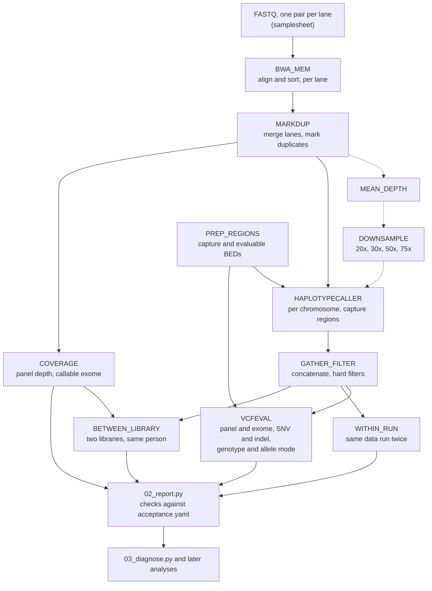

# ngs-panel-validation

Before a clinical genetics laboratory reports DNA variants from a sequencing pipeline, it has to show two things: that the pipeline finds the variants that are really there, and that it does not report variants that are not. It has to show this again whenever the pipeline changes, even for a small edit to a filter or a tool version. This project does that work for a small germline pipeline and writes it up the way a diagnostic laboratory would, following the AMP/CAP guidelines for validating NGS bioinformatics pipelines (Roy et al. 2018, reference below).

## What the project does

The pipeline looks for inherited variants in 31 genes linked to hereditary breast, ovarian and colorectal cancer, including BRCA1, BRCA2, PALB2, the mismatch repair genes MLH1, MSH2, MSH6 and PMS2, APC and TP53. The gene list comes from PanelApp Australia.

To score a pipeline you need samples where the right answer is already known. The Genome in a Bottle consortium (GIAB, run by NIST) has sequenced a few reference cell lines many times with different technologies and published a benchmark set of their variants. This project uses five of them. HG001 (NA12878) was sequenced at the Garvan Institute as two separate exome libraries. HG002 to HG005 (an Ashkenazi son and his parents, and an unrelated Han Chinese son) were sequenced at Oslo University Hospital with a different capture kit (Agilent SureSelect V5) and at higher depth.

The steps are:

1. Align the sequencing reads to the human reference genome (BWA-MEM).
2. Call variants and apply quality filters (GATK HaplotypeCaller and hard filters).
3. Compare the calls with the GIAB benchmark inside the panel genes (RTG vcfeval). Sensitivity is the share of true variants found; precision is the share of reported variants that are true.
4. Check coverage, and run the same data twice and two libraries of the same person, to see whether results repeat.
5. Judge the results against acceptance criteria written in `config/acceptance.yaml` before any results were produced, so the bar cannot be moved after seeing them.

## What was found

The first version failed. Working out why was the most useful part. All three panel variants missed in the first library had been called correctly and then removed by one rule of the standard GATK filter, a strand bias test (SOR) that misbehaves at homozygous sites. That is a fault in the pipeline. The other failures came from the data rather than the pipeline: the exome was sequenced to about 50x, far shallower than a diagnostic panel, the exome kit does not capture 19% of the panel's coding sequence, and most false indels sit next to long single-base repeats, a known error of PCR-amplified libraries.

The fix went through change control. A written plan came first. Candidate filters were compared on the odd-numbered chromosomes, and the chosen one was tested on the even-numbered chromosomes, so the test data played no part in the choice. Removing the SOR rule raised panel SNV sensitivity from 50/53 and 51/53 (the two libraries) to 53/53 in both, with no loss of precision, and the change was accepted. HG001 also has only 53 benchmark variants in these genes, too few for even 53/53 to show the 0.99 target on its own.

Report 03 ran the pipeline on four more GIAB genomes (HG002 to HG005), sequenced by a second laboratory with a different capture kit at 114x to 140x. Over the five genomes no panel SNV was missed (316/316), and change 02 held up on these genomes, which played no part in choosing it. The deeper data still failed the exome-wide criteria, which showed that report 01's explanation was incomplete: outside GIAB's difficult regions (segmental duplications, low mappability, homopolymers) SNV sensitivity is 0.996 to 0.998, and the failures sit inside them. The laboratory's own calls on the same reads fail the same criteria. The one panel precision failure is a pair of false calls in PMS2, whose pseudogene PMS2CL limits what short reads can show there.

The rest of this README gives the figures, the layout and how to run it.

## Results in figures

GIAB HG001, Garvan Nextera exome (about 50x), 31-gene hereditary cancer panel from PanelApp Australia. Figures are for NIST7035 where only one is given; full figures and reasoning are in `docs/reports/`.

| | v1 (report 01) | v2 (report 02) | Criterion |
|---|---|---|---|
| Panel SNV sensitivity | 50/53, 51/53 | 53/53 (95% CI 0.93-1.00) | 0.99 |
| Panel SNV precision | 1.000 | 1.000 | 0.99 |
| Exome SNV sensitivity / precision | 0.844 / 0.983 | 0.903 / 0.981 | 0.99 |
| Exome indel sensitivity / precision | 0.754 / 0.768 | unchanged | 0.95 |
| Panel bases at >= 20x | 0.845 | unchanged | 0.98 |
| Within-run (same data run twice) | identical | identical | identical |
| Between-library concordance, panel | 0.944 | 0.982 | 0.99 |

v1 failed validation. The diagnosis separated a pipeline fault (the SOR rule of the generic SNP hard filter removed true homozygous calls) from limits of the data (shallow exome, 19% of the panel's coding sequence not captured, homopolymer indel errors). Change 02 removed the SOR rule. The candidate was chosen on odd autosomes and tested on even autosomes against a plan fixed beforehand, and it passed change control.

HG002 to HG005, Oslo SureSelect V5 exomes (114x to 140x), v2 (report 03). Ranges are over the four genomes.

| | v2 | Criterion |
|---|---|---|
| Panel SNV sensitivity | 59/59 to 72/72 per genome; 316/316 over five genomes with HG001 | 0.99 |
| Panel SNV precision | 0.969 to 1.000 (PMS2 pseudogene calls in two genomes) | 0.99 |
| Exome SNV sensitivity / precision | 0.979-0.982 / 0.993-0.994 | 0.99 |
| Exome SNV sensitivity outside difficult regions | 0.996-0.998 | 0.99 |
| Exome indel sensitivity / precision | 0.89-0.94 / 0.89-0.94 | 0.95 |
| Panel bases at >= 20x | 0.974-0.976 | 0.98 |
| Change 02 on these genomes, exome SNV sensitivity v1 → v2 | 0.93-0.94 → 0.98, precision within 0.0003 | |

## Approach

The pipeline itself is ordinary (BWA-MEM, GATK HaplotypeCaller). The point of the project is the evidence around it:

- **Accuracy**: SNV and indel sensitivity and precision against the NIST v4.2.1 benchmark, restricted to the genes of a hereditary cancer panel, with RTG vcfeval.
- **Reproducibility**: the two Garvan HG001 exome libraries (NIST7035 and NIST7086) compared with each other, and NIST7035 run twice end to end, to show between-library and within-run agreement.
- **Change control**: a pipeline change (tool version or parameter) run against the same data, with a before/after verification report and an accept or reject decision against predefined criteria.
- **Further checks** (report 03): panel accuracy pooled over the five genomes, an independent check of change 02, coverage of ClinVar pathogenic sites, a depth series made by downsampling HG002, accuracy by GIAB difficult-region stratum with a closer look at PMS2, sample identity, sex and trio consistency, and a comparison with the sequencing laboratory's own calls.
- **Run QC** (report 04): per-sample metrics (reads, mapping, duplicates, depth, variant counts, Ti/Tv, het/hom, share in dbSNP) checked against ranges set for each assay, as the NPAAC requirements ask.
- **Documentation**: an SOP (`docs/sop/SOP-01-germline-panel-pipeline.md`) covering running, checks, validation and change control, with templates for plans and reports.

Acceptance criteria are fixed in `config/acceptance.yaml` before any results are generated.

## Scope

What is validated: germline SNVs and small indels (up to about 50 bp) in the coding sequence, with 20 bp either side, of 31 hereditary breast, ovarian and colorectal cancer genes, from Illumina short-read exome data aligned to GRCh37. The samples are GIAB reference genomes (HG001 to HG005) sequenced by two laboratories with two capture kits, not patient samples.

What is not, and why:

- Copy number changes and exon-level deletions. These matter for genes such as BRCA1, BRCA2 and the mismatch repair genes, but GIAB has no exome-scale truth set for them, so they could not be validated here.
- Structural variants, and variants outside the panel targets (deep intronic, promoter).
- Somatic, mosaic and low allele fraction variants. The pipeline is a germline caller; these need a different caller and samples with known allele fractions, such as GIAB genomes mixed in set proportions.
- Variant classification and clinical reporting, and the laboratory side (extraction, library preparation, sequencing).

The acceptance criteria and SOP were written for this project with reference to AMP/CAP and to the NPAAC requirements for massively parallel sequencing that Australian laboratories are accredited against. This is not a NATA-accredited laboratory and the criteria and SOP are not the procedures of one; the second-person review the SOP asks for was done by the author alone. `docs/npaac-mapping.md` lists which NPAAC bioinformatics and quality requirements the project covers and which it does not. Reasons for the main choices are in `docs/design-decisions.md`.

## Pipeline

Processes in `workflow/main.nf`, then the report scripts. The dashed steps run only when a genome's params file sets `downsample` (HG002 in report 03).



## Where to start reading

1. `docs/reports/01-initial-validation/README.md` and `docs/reports/02-snv-filter-change/README.md`: what was tested, what failed and why, and how the change was accepted.
   Then `docs/reports/03-more-reference-samples/README.md`: four more genomes from a second laboratory, and where report 01's explanation was incomplete.
   `docs/reports/04-run-qc/README.md`: run QC metrics and their acceptable ranges.
2. `config/acceptance.yaml`: the criteria the results are judged against.
3. `workflow/main.nf`: the pipeline, one process per step in the diagram above.
4. `scripts/02_report.py`, then `03_diagnose.py`, `04_split_eval.py` and `05_change_control.py` for the change-control steps.
5. `docs/sop/SOP-01-germline-panel-pipeline.md`: how the pipeline is run, checked and changed.
6. `docs/design-decisions.md`: why the main choices were made and what the alternatives were.
7. `docs/npaac-mapping.md`: the NPAAC requirements this work does and does not cover.

## Layout

```
config/      pipeline parameters, panel definition, acceptance criteria
workflow/    Nextflow pipeline
scripts/     panel BED construction, benchmarking and report scripts
data/        panel BED files (committed); raw data and references (not committed, see data/README.md)
docs/sop/    standard operating procedure and report templates
docs/design-decisions.md  reasons for the main design choices
docs/npaac-mapping.md     NPAAC requirements against this project
docs/reports/ validation and verification reports
```

## Running

```
conda env create -f environment.yml          # env path must not contain spaces
scripts/00_download.sh panel && scripts/00_download.sh reference && scripts/00_download.sh reads
python3 scripts/01_build_panel.py
nextflow run workflow/main.nf -profile local
python scripts/02_report.py --name <report-name>
python scripts/03_diagnose.py --name <report-name>    # why calls were missed or false
scripts/00_download.sh dbsnp && python scripts/11_run_qc.py --genomes HG001   # run QC against config/run_qc.yaml
```

For a pipeline change: write the plan, choose between candidates with `scripts/04_split_eval.py --set dev`, rerun the pipeline with `--outdir results_v2`, then `04_split_eval.py --set test --dirs results results_v2` and `scripts/05_change_control.py`. Run the Python scripts inside the conda env.

`config/samplesheet.csv` lists the lanes; `nextflow.config` holds paths and resource limits.

## Status

Reports 01 (initial validation), 02 (SNV filter change) and 03 (HG002 to HG005 from a second laboratory and capture kit) are complete, report 04 sets run QC ranges, and SOP-01 is written (version 1.1). Report 03 ends with three possible changes (judging exome-wide accuracy outside difficult regions, handling PMS2, flagging homopolymer indels), none made yet.

## References

Roy S, et al. Standards and guidelines for validating next-generation sequencing bioinformatics pipelines: a joint recommendation of the Association for Molecular Pathology and the College of American Pathologists. J Mol Diagn. 2018;20(1):4-27. doi:10.1016/j.jmoldx.2017.11.003. PMID: 29154853.

National Pathology Accreditation Advisory Council. Requirements for Human Medical Genome Testing Utilising Massively Parallel Sequencing Technologies (First Edition 2017). Canberra: Commonwealth of Australia; 2017. ISBN 978-1-76007-290-2 (online). https://www.safetyandquality.gov.au/resources/requirements-human-medical-genome-testing-utilising-massively-parallel-sequencing-technologies-first-edition-2017 (accessed 2026-10-25).
